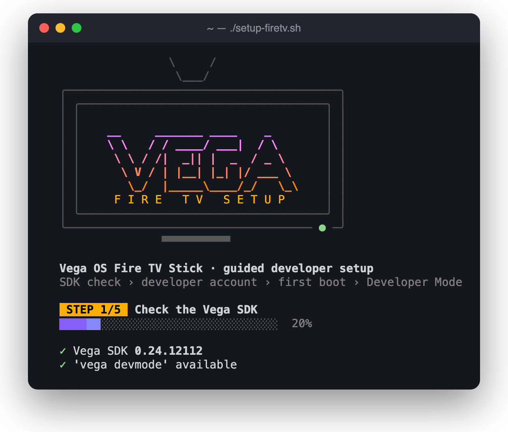
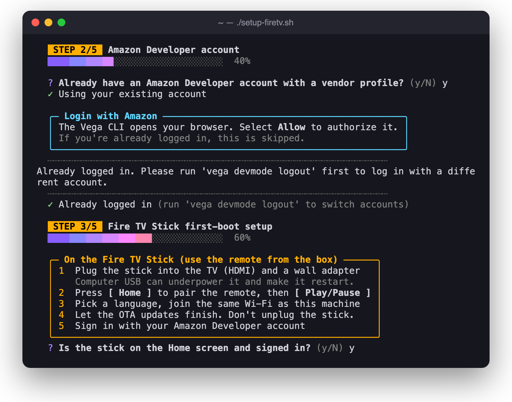
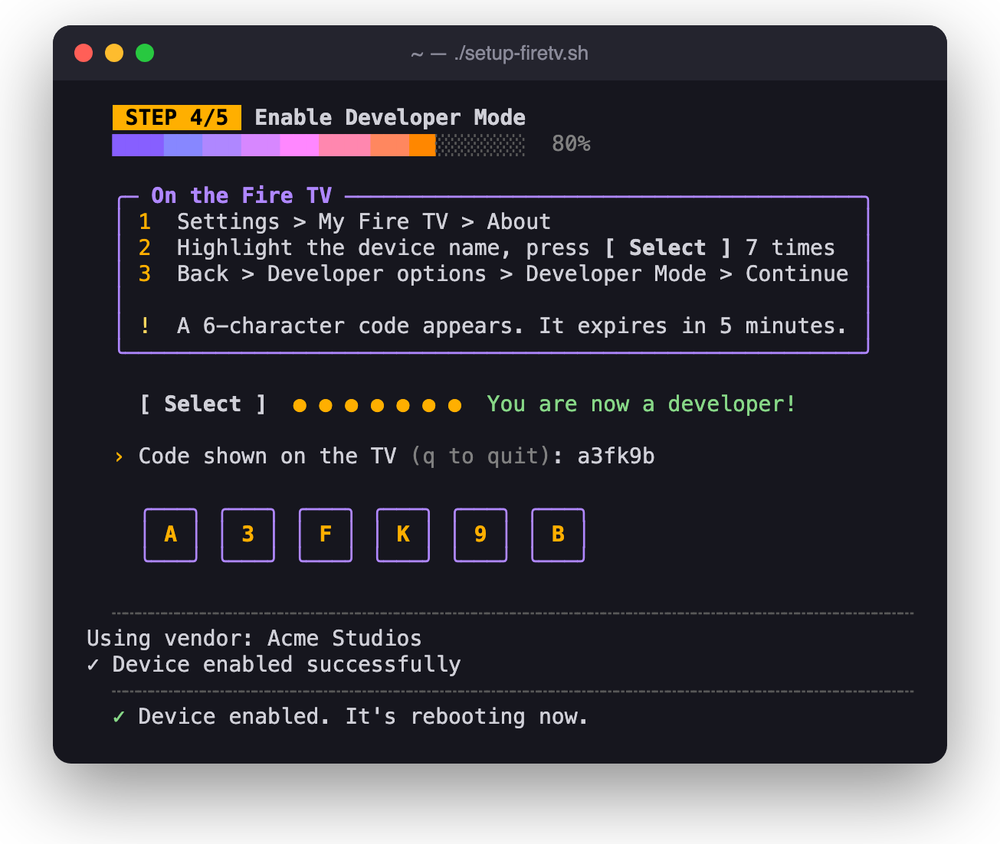
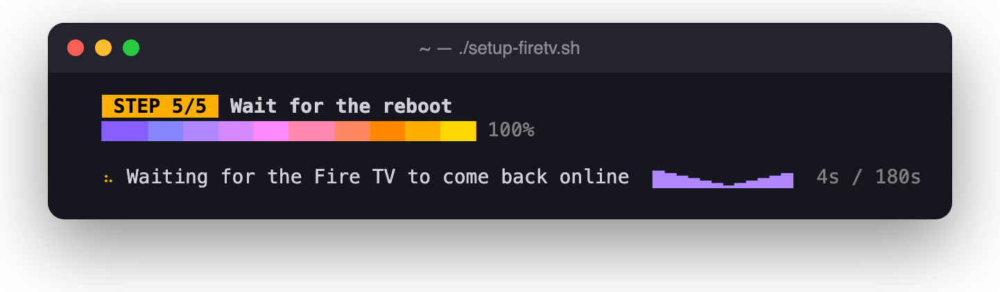
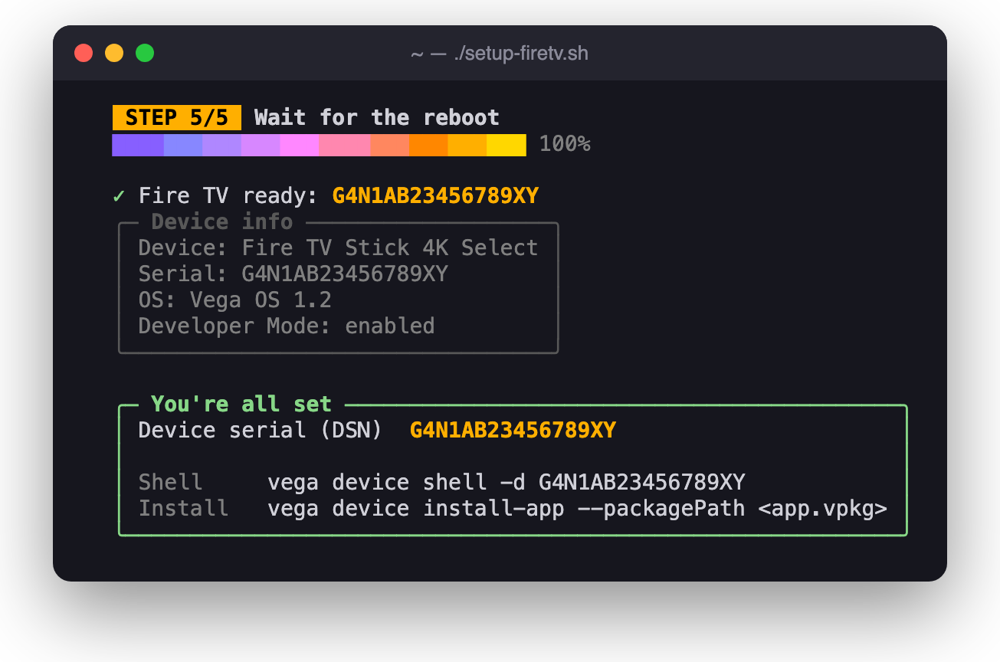

# Vega Fire TV Setup

> Take a Vega OS Fire TV Stick from out of the box to Developer Mode enabled, guided step by step in your terminal.



`setup-firetv.sh` is a single, dependency-free Bash script. It checks your Vega SDK, signs the Vega CLI in to your Amazon Developer account, walks you through first boot on the Fire TV Stick, enables Developer Mode with the code shown on the TV, and confirms the device is reachable. Every step is explained on screen, and the script recovers from common errors such as an expired code or session.

## Contents

- [Features](#features)
- [Requirements](#requirements)
- [Installation](#installation)
- [Quick start](#quick-start)
- [Usage](#usage)
- [How it works](#how-it-works)
- [Error handling](#error-handling)
- [Troubleshooting](#troubleshooting)
- [FAQ](#faq)
- [References](#references)
- [License](#license)

## Features

- **End-to-end guidance.** Covers five steps: SDK check, developer account, first boot, Developer Mode, verification.
- **Automates what can be automated.** It runs the `vega devmode` and `vega device` commands, waits for the device to reboot, and reads the device serial number (DSN).
- **Recovers from errors.** Expired codes and expired login sessions are retried automatically, and failures explain the next step.
- **Skips work already done.** If a connected device already has Developer Mode on, the script offers to skip straight to the end.
- **Terminal UI.** Animated banner, per-step progress bar, spinners, instruction cards, and readable output in plain terminals.
- **Script-friendly.** Supports `--yes`, `--vendor`, and `NO_COLOR`. Animations turn off automatically when output isn't a terminal.

## Requirements

| Requirement | Details |
| --- | --- |
| OS | macOS 10.15+ or Ubuntu 20.04+ |
| Shell | Bash 3.2+ (the macOS default works) |
| Vega SDK | [0.24 or later](https://developer.amazon.com/docs/vega/0.24/install-vega-sdk.html), with `vega devmode` available |
| Account | An [Amazon Developer account](https://developer.amazon.com/) with a vendor (company) profile. The script helps you create one. |
| Hardware | A Fire TV device running Vega OS, its original remote, and a TV with HDMI |
| Network | Your computer and the Fire TV on the same network |
| Terminal | A UTF-8 terminal. 256-color support recommended. |

## Installation

No build step and no dependencies beyond the Vega SDK. Clone the repository:

```bash
git clone https://github.com/giolaq/vega-firetv-setup.git
cd vega-firetv-setup
```

Or download just the script and make it executable:

```bash
curl -fsSLO https://raw.githubusercontent.com/giolaq/vega-firetv-setup/main/setup-firetv.sh
chmod +x setup-firetv.sh
```

## Quick start

```bash
./setup-firetv.sh
```

Then follow the prompts. When the script finishes, it prints your device serial number (DSN), which you'll need for `vega device` commands.

## Usage

```text
./setup-firetv.sh [--vendor <VENDOR_ID>] [--skip-account] [--yes] [--no-anim]
```

| Option | Description |
| --- | --- |
| `--vendor <VENDOR_ID>` | Vendor ID to pass to `vega devmode enable-device`. Skips the vendor prompt when your account has more than one vendor. |
| `--skip-account` | Skip the account questions and go straight to `vega devmode login`. |
| `--yes`, `-y` | Answer "yes" to every yes/no prompt. |
| `--no-anim` | Turn off animations (spinners, TV power-on, confetti). |
| `--help`, `-h` | Show usage and exit. |

| Environment variable | Effect |
| --- | --- |
| `NO_COLOR` | Any value turns off colors ([no-color.org](https://no-color.org/)). |
| `TERM`, `COLORTERM` | Set the color depth: 256 colors when `TERM` contains `256color` or `COLORTERM` is set, 8 colors otherwise. |
| `TMPDIR` | Where log files are written (`$TMPDIR/firetv-setup.XXXXXX`). |

### Examples

```bash
# Account and CLI login already set up; use a specific vendor
./setup-firetv.sh --skip-account --vendor M1ABCDEFGHIJK

# Plain output, e.g. for screen readers or recording logs
NO_COLOR=1 ./setup-firetv.sh --no-anim
```

### Exit codes

| Code | Meaning |
| --- | --- |
| `0` | Developer Mode is enabled and the device is visible to the Vega CLI. |
| `1` | Setup stopped. The message explains why, and logs are in `$TMPDIR/firetv-setup.*`. |
| `130` | Interrupted with Ctrl-C. |

## How it works

### 1. Check the Vega SDK

Confirms that the active SDK is 0.24 or later and that `vega devmode` is available. If `vega` isn't on your `PATH`, the script loads `~/vega/env` first.

### 2. Amazon Developer account

If you don't have an account yet, the script opens [developer.amazon.com](https://developer.amazon.com/) and lists what to fill in. It then runs `vega devmode login`, which opens a browser so you can authorize the Vega CLI. If you're already logged in, nothing opens.

### 3. Fire TV Stick first-boot setup

Shows a checklist for first boot: HDMI and power, remote pairing, Wi-Fi, OTA updates, and signing in with the **same** Amazon account.



### 4. Enable Developer Mode

Lists the on-device steps (**Settings > My Fire TV > About**, then press **Select** 7 times on the device name), asks for the 6-character code shown on the TV, and runs `vega devmode enable-device`.



### 5. Wait for the reboot

Checks `vega device list` in the background, for up to 3 minutes, until the device comes back. Then it prints the DSN and the device info.





> Screenshots show sample device data.

## Error handling

| Situation | What the script does |
| --- | --- |
| Already logged in (`vega devmode login` exit 2) | Continues with the current account. Run `vega devmode logout` first to switch accounts. |
| Code invalid or expired (`enable-device` exit 6) | Asks for a new code. On the TV, choose **Request a New Code**. |
| Session missing or expired (`enable-device` exit 2 or 3) | Logs out, logs in again, and asks for a new code. |
| No vendor profile (`enable-device` exit 4) | Stops. Finish your developer profile on developer.amazon.com and run the script again. |
| Device not seen after 3 minutes | Stops with troubleshooting hints. |
| A captured command fails | Shows the last 15 lines of that command's log and the log path. |

## Troubleshooting

<details>
<summary><strong>The stick restarts during setup</strong></summary>

It's probably underpowered. Use the wall adapter instead of a computer USB port.
</details>

<details>
<summary><strong>The device isn't listed after the reboot</strong></summary>

1. Check that **Settings > My Fire TV > Developer options > Developer Mode** shows *Enabled*.
2. Connect the stick to your computer over USB.
3. Run `vega device list`.
4. Make sure a firewall isn't blocking local network discovery.
</details>

<details>
<summary><strong><code>vega devmode</code> isn't available</strong></summary>

Your SDK is too old. Install 0.24 or later, then update the CLI:

```bash
vega sdk install 0.24.12112 && vega sdk use 0.24.12112
vega update
```
</details>

<details>
<summary><strong>Boxes or symbols look broken</strong></summary>

Use a UTF-8 terminal and a font with box-drawing characters (for example Menlo, SF Mono, or JetBrains Mono). Or run with `--no-anim` and `NO_COLOR=1`.
</details>

## FAQ

**Can the script run fully unattended?**
No. Some steps are deliberately gated on a person. Amazon account sign-up requires CAPTCHA and phone verification, and automated sign-ups violate the Amazon Developer Services terms. Login with Amazon needs you to approve access in a browser. Developer Mode needs someone at the device to read the code off the TV. The script automates everything around those steps. The CLI login is stored in your keychain, so you only approve it once per machine.

**Do I need to run it again after a reboot?**
No. Developer Mode stays on until a factory reset.

**How do I turn Developer Mode off?**
Factory reset the device.

## References

- [Run Your App on Vega Virtual Device or Fire TV](https://developer.amazon.com/docs/vega/0.24/run-apps.html)
- [Enable Developer Mode](https://developer.amazon.com/docs/vega/0.24/developer-mode.html)
- [Resolve Fire TV Stick Issues](https://developer.amazon.com/docs/vega/0.24/fire-tv-stick.html)
- [Install the Vega SDK](https://developer.amazon.com/docs/vega/0.24/install-vega-sdk.html)

## License

MIT No Attribution (MIT-0). See [LICENSE](LICENSE).
